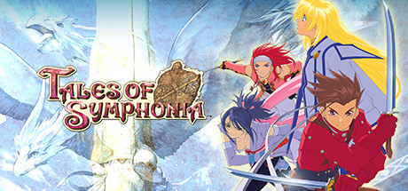

**Tales of Symphonia is the beloved entry following Lloyd Irving accompanying the Chosen Colette on a world regeneration journey, only to discover civilization-shaking truths about their world. Features the Linear Motion Battle System and one of the Tales series' deepest stories.**

---

## 📖 About

Tales of Symphonia is the beloved entry following Lloyd Irving accompanying the Chosen Colette on a world regeneration journey, only to discover civilization-shaking truths about their world. Features the Linear Motion Battle System and one of the Tales series' deepest stories.

## ⚠️ Problems Without Trainer

| Problem | Status |
|---------|--------|
| **Grade Farming** — Earning enough Grade for New Game+ transfers requires specific battle ratings | ✅ Solved |
| **Coliseum Battles** — One-on-one Coliseum fights restrict party to individual character mastery | ✅ Solved |
| **Collector's Book** — Completing the full item collection requires multiple NG+ playthroughs | ✅ Solved |
| **Presea Early Game** — New party member joins severely underleveled requiring grinding | ✅ Solved |

## ✅ Solution

The **Tales of Symphonia Trainer** solves all these issues by giving you complete control over the game.

## 🎯 Full Feature List

- Unlimited Resources
- God Mode / Invincibility
- Instant Skill Cooldown
- One-Hit Kill
- Freeze Game Timer
- Unlock All Items & Achievements
- Custom Speed Multiplier
- Save State Anywhere

## 🚀 Quick Start

1. **Disable Windows Defender** temporarily (trainer may trigger false positive)
2. Download the trainer from the button above
3. Launch Tales of Symphonia
4. Run the trainer as Administrator
5. Activate desired cheats with hotkeys

## 💎 Free vs Paid

| Feature | Free | Pro |
|---------|------|-----|
| Basic God Mode | ✅ | ✅ |
| Unlimited Resources | ✅ | ✅ |
| All Advanced Cheats | ❌ | ✅ |
| Auto-Updates | ❌ | ✅ |
| Priority Support | ❌ | ✅ |

## 💻 Requirements

- Windows 10/11 (64-bit)
- Tales of Symphonia (any version)
- .NET Framework 4.8+
- DirectX 11+

## 🍎 macOS

macOS users can use our alternative tool:

## ⚖️ Legal

This trainer is for educational and single-player use only. Use responsibly.

---

